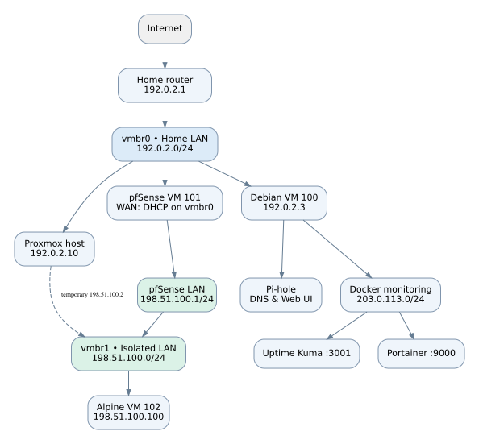

# Proxmox Linux & Network Security HomeLab

**A hands-on infrastructure, Linux administration and network security project, built on a Lenovo ThinkPad X201 (4 GB RAM / 128 GB SSD).**

> **Publication note:** All deployment IPv4 addresses use RFC 5737 TEST-NET documentation-only ranges, not real network addresses. These examples are not operational subnets. Commands containing them are illustrative and must not be run verbatim. No public WAN IP is included.

> **Status:** Debian/Docker stack and pfSense lab tested. Remote VPN and full disaster-recovery verification are **not implemented**.

## Project overview

This project explores operating a small virtualized infrastructure under strict hardware constraints. It combines Linux services, container monitoring, layered firewall controls, an isolated pfSense lab network, and documented troubleshooting.

### Technology stack

| Component | Role |
| --- | --- |
| Proxmox VE | Hypervisor, virtual bridges and VM firewall |
| Debian Linux (VM 100) | Pi-hole, Docker, Portainer and Uptime Kuma |
| pfSense CE 2.9.0 (VM 101) | Lab firewall, NAT, DHCP and routing |
| Alpine Linux (VM 102) | Lightweight network test client |
| UFW + Docker `DOCKER-USER` | Host and Docker-forwarded traffic policies |
| SSH local port forwarding | Access to isolated pfSense management UI |

## Architecture

- **Management/home LAN (`192.0.2.0/24`)** runs on `vmbr0`. Proxmox management is at `192.0.2.10`; Debian is at `192.0.2.3`.
- **Isolated lab LAN (`198.51.100.0/24`)** runs on `vmbr1`, which has **no physical bridge port**. The pfSense WAN is on `vmbr0` (DHCP; observed `192.0.2.16`), and LAN is `198.51.100.1/24`.
- **Alpine test VM** connects **only** to `vmbr1` and was assigned `198.51.100.100` by pfSense DHCP.
- **Docker `monitoring` network:** `203.0.113.0/24`; Uptime Kuma checks Portainer by Docker DNS at `http://portainer:9000`.
- **pfSense web administration** was reached via an SSH tunnel on Proxmox, using a **temporary** `198.51.100.2/24` address on `vmbr1`.

**Important:** pfSense does **not** replace the home router, and the Debian VM is **not** behind pfSense. The pfSense instance routes only its isolated test network in this design.

## Implemented and validated

- [x] Debian minimal server and SSH access
- [x] Pi-hole DNS filtering service
- [x] Docker containers: Portainer and Uptime Kuma
- [x] Debian UFW allowlist for home LAN
- [x] Docker `DOCKER-USER` rules restored by systemd Docker `ExecStartPost`
- [x] Proxmox host and Debian VM firewall rules
- [x] pfSense CE installation, WAN DHCP and LAN static address
- [x] Alpine DHCP lease, gateway reachability, Internet ping and DNS tests
- [x] Targeted ICMP BLOCK rule applied, verified, then removed
- [x] pfSense GUI accessed through SSH local forwarding
- [x] Debian Docker restart after reboot tested successfully
- [ ] WireGuard or Tailscale remote access (deliberately deferred)
- [ ] Tested full VM backup and restore
- [ ] End-to-end external exposure audit / penetration test

## Troubleshooting highlight

**Problem:** Containers configured with `192.0.2.3:3001` and `192.0.2.3:9000` failed after Debian reboot with `bind: cannot assign requested address`.

**Investigation:** `docker inspect`, container states and Docker daemon logs revealed that the host IPv4 address was not yet available when Docker attempted to bind the published ports.

**Resolution:** Recreated the containers with explicit IPv4-only host bindings (`0.0.0.0:3001:3001`, `0.0.0.0:9000:9000`), retaining persistent data volumes, while restricting forwarded ingress using `DOCKER-USER`. A subsequent Debian reboot confirmed both containers started and monitoring checks succeeded. **Note:** Binding to `0.0.0.0` is not itself an access restriction; firewall policy remains essential.

## Documentation

1. [Proxmox and VM layout](docs/01-proxmox-setup.md)
2. [Debian and Pi-hole](docs/02-debian-server.md)
3. [Docker services and monitoring](docs/03-docker-services.md)
4. [Firewall design](docs/04-firewall-configuration.md)
5. [pfSense networking](docs/05-pfsense-networking.md)
6. [Testing and troubleshooting](docs/06-testing-troubleshooting.md)
7. [Backup and disaster recovery roadmap](docs/07-backup-recovery.md)
8. [Security and publication notes](SECURITY.md)

## Lessons learned

- Stateful firewall policies and Docker NAT/forwarding require separate verification.
- A user-defined Docker network supports service discovery by name rather than fragile container IPs.
- Startup dependencies matter when publishing ports on a specific host IP.
- Firewall changes should be applied and tested incrementally with safe management access retained.
- Validation matters: separate ping, DNS, browser, container connectivity and reboot checks tell different stories.

## Scope and safety

All network addresses in this repository are **anonymized RFC 5737 documentation addresses** and are not the actual deployed address plan. No passwords, VPN keys, tokens or complete router configuration are included. Screenshots are intentionally omitted pending review and redaction. A successful lab test is **not** a guarantee of Internet-facing security.

**Environment:** Personal educational HomeLab. Not a production deployment.
